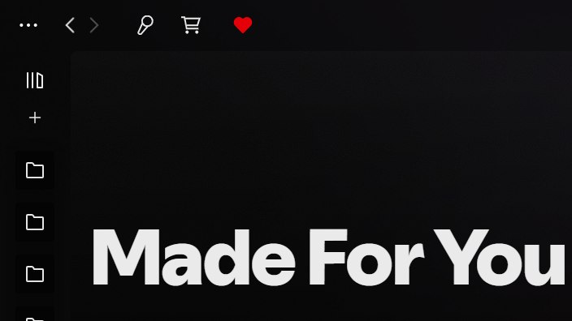

# Made For You Button

A **Made For You** button for [Spicetify](https://spicetify.app). It sits in Spotify's top bar beside your custom app icons and opens your Made For You page (your mixes, Discover Weekly, Release Radar) in one click.



## Features

- **One click** to Made For You, the same page as Spotify's own **Alt+Shift+M** shortcut
- **Looks native:** a heart that's outlined normally and filled while you're on the page, like Spotify's other top-bar buttons
- **Fits any theme:** it uses Spotify's own button, so it takes its colours from the theme you have

## Install

1. Download [`made-for-you-button.js`](made-for-you-button.js).
2. Put it in your Spicetify `Extensions` folder. To find that folder, run `spicetify path userdata` and look inside it for `Extensions`.
3. Run:
   ```
   spicetify config extensions made-for-you-button.js
   spicetify apply
   ```

## Requirements

Tested on Spotify 1.3.6 with Spicetify 2.46.

The button goes in the area Spicetify adds for custom app icons. Spicetify only adds that area when at least one custom app is turned on, such as Marketplace or [Lyrics Plus](https://github.com/spicetify/cli/tree/main/CustomApps/lyrics-plus). If you installed this through Marketplace, you already have one.
